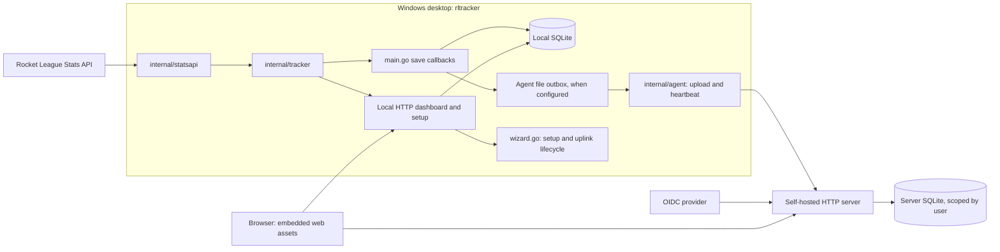
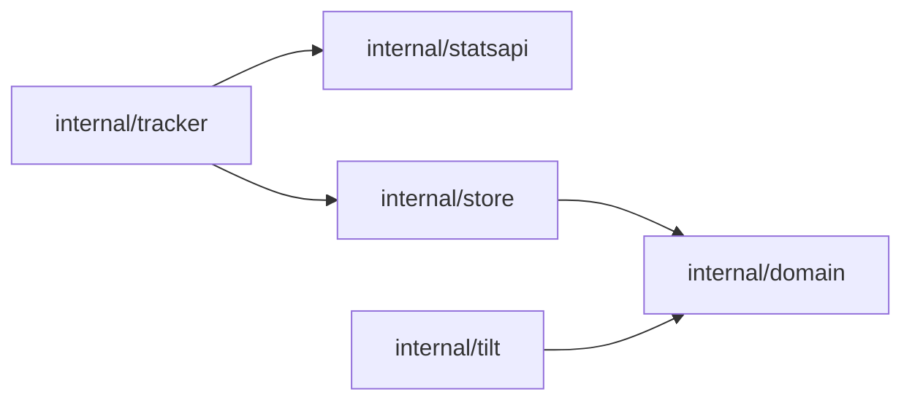

# Architecture and domain map

Rocket Tracker records a player's game telemetry and presents history,
statistics and training aids. It has a Windows desktop executable and a
separate self-hosted server. Both embed the same dashboard from `web/`.

## Runtime ownership

`main.go` composes collection, persistence, desktop notifications and the local
HTTP server. The tracker interprets game events and invokes injected save
callbacks. It does not issue SQL. `internal/store` owns SQLite schema migrations,
ingestion, scoped persistence and queries. The tracker uses its compatibility
aliases for match values and its training type.

`wizard.go` configures Stats API access, server credentials and autostart. Its
uplink runs the agent beside the local store. `rltracker agent` is now an alias
for the normal desktop runtime; it does not launch a second tracker-only mode.

`cmd/rltracker-server/main.go` composes the shared HTTP package with a `Hub`.
`Server.Hub == nil` selects local behavior; a non-nil hub enables server
authentication, device APIs and user scopes. The setup routes instead use the
narrow `server.Setup` interface, implemented by the Windows wizard.

## Shared match model boundary

`internal/domain` owns `Match`, `MeStats`, `Player`, `Movement`, `Hits`,
`HitPoint`, `Vec`, `Demolition` and `Goal`, along with `Match.Normalize`,
`ProfileKey` and `SameProfile`. Its production imports are only `strings` and
`time`. `internal/store/model.go` exposes aliases for these types and delegates
the two profile functions to the domain. Existing callers can keep using the
store names, including the Normalize method, with the same JSON representation.
Tilt consumes `domain.Match` directly and has no production dependency on store.

Current code dependencies for this boundary are:

This extraction preserves field names, JSON tags, time normalization, profile
identity, telemetry absence and units. Normalize fills derived fields and
required collections; it does not validate ingestion quantities. Store still
enforces ownership and deduplication when writing data. `Training`, its
normalization, focus rules and merge remain in store. The tracker still imports
store and Stats API DTOs; observations, application use cases, save callbacks
and the DB/outbox sequence remain in their existing owners.

## Data and domain vocabulary

| Concept | Current representation and meaning |
|---|---|
| Server user | OIDC-backed account; owns stored data and devices. Local mode uses `store.LocalUser`. |
| Rocket League profile | The in-game account represented by `Match.Me`; `domain.ProfileKey` (also available through `store.ProfileKey`) prefers a normalized platform ID, then a normalized name. A user can have several profiles. |
| Match | One player's perspective of a game, with `win`, `loss` or `abandoned` result, player/team snapshots and optional telemetry. Stored once per user, GUID and profile (`matches.profile`); offline matches also match on their start time, so a live upload and a later import give one row. Rows without a profile match any profile. |
| Partial match | Collection began after the game started; earlier events can be absent. `Partial` preserves this distinction. |
| Device | An upload credential associated with a server user. Revoking it stops future authenticated device requests. |
| Training | A game-observed solo offline session or browser warm-up timer; nearby observations can merge. Focus and account are separate fields. |
| Manual day | Hand-entered counts of games/wins for a date and mode, rather than reconstructed telemetry. |
| Rank/MMR entry | A manually recorded observation. The Stats API does not supply MMR. |
| Play session | An analytical grouping based on a 30-minute gap, distinct from an authentication session. |
| Authentication session | Server-side login record plus a browser cookie. |

Tracking and inference rules are implemented in `internal/tracker/`: explicit
player IDs/names take precedence over camera-based identity detection; spectator
signals constrain automatic detection. Solo offline play of at least one minute
can become training. An interrupted sufficiently progressed match can be saved
as abandoned and later replaced after reconnection.

`Match.Tag` is an editable classification, not an authoritative playlist from
the game. Speeds are generally stored in game units per second and converted for
display; touch/goal positions use the tracked player's team orientation. Older
records can lack movement, touch points, goal impacts or demolition data. Check
the source and [SPEC.md](SPEC.md) before changing units or missing-value rules.

## Saving, delivery and editing

Desktop save callbacks write SQLite, request a checkpoint, then queue a file when
a server is configured, even while the agent restarts. These are separate
writes: nothing re-queues local rows later. The agent retries queued data,
removes acknowledged files and retains rejected files separately. Queued entries
carry a transport key and payload; the outbox records its server in
`outbox/destination`, and switching server moves pending entries to
`outbox-<host>-<time>` instead of sending them to the new one. Replaying a
training merges into the stored row, keeping an edited focus.

Connecting a server does not automatically import all existing local history.
`rltracker agent import` and server/dashboard imports provide explicit recovery
paths. Browser edits and timers write through HTTP handlers to the selected
store; they are not a general bidirectional replication system. Check the exact
path before promising that a local edit will appear on the server.

The server authenticates device requests separately from browser sessions.
Shared player pages intentionally allow authenticated read-only access to other
players; mutation routes use the signed-in user's scope. User isolation and
intended social visibility must both survive refactoring.

## Browser and analytics

`web/app.js` begins with pure analytical functions exported through
`module.exports` for Node and a browser global. Its remaining section owns
requests, routes, mutable page state, rendering, live views and warm-up timers.
The dashboard generally loads match history and computes analytics in the
browser. Server leaderboards use store aggregates.

Status is polled every three seconds. `/status` carries `data_rev`, an
in-memory per-user revision that changes on every write; the lists reload when
it changes (or, from an older server, when the counts change). A failed load is
retried at the next poll. Generation checks on the history loaders, and a
sequence on the leaderboard, reject responses from an earlier request.
Selecting an in-game profile filters already-loaded data.

Training suggestions and live historical win rates are descriptive calculations
from the available sample. They are not evidence that a mechanic causes a win,
nor an official matchmaking prediction. Keep sample size, eligibility and
missing telemetry explicit in changes to those features.

## Further reading

- [Development and verification](DEVELOPMENT.md): commands, platforms and CI.
- [Specification](SPEC.md): detailed payloads and detection rules; verify older
  launch descriptions against the current entrypoints.
- [Self-hosting](SELF_HOSTING.md): authentication, proxy, devices and backups.
- [Agent guide](../AGENTS.md): change rules and source navigation.
