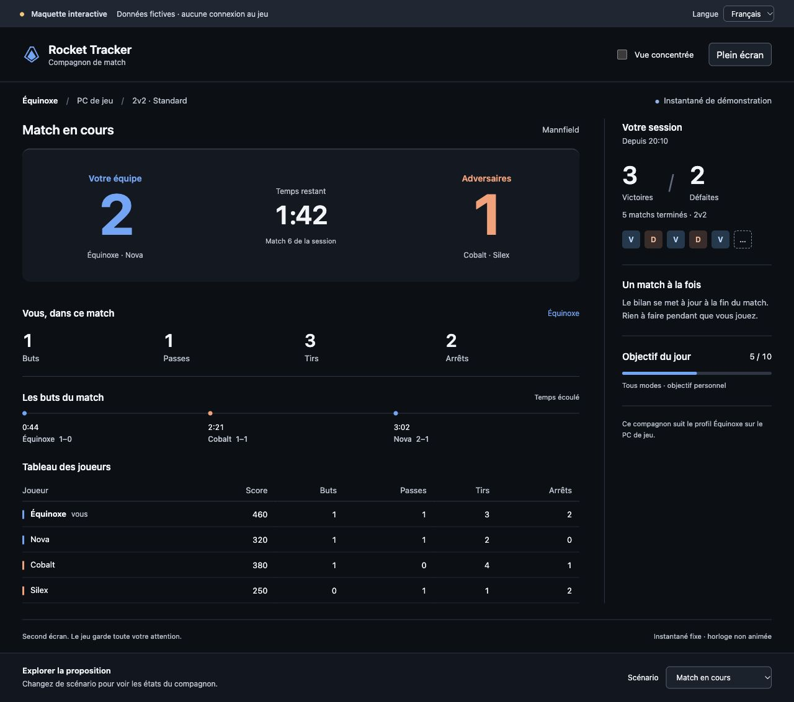
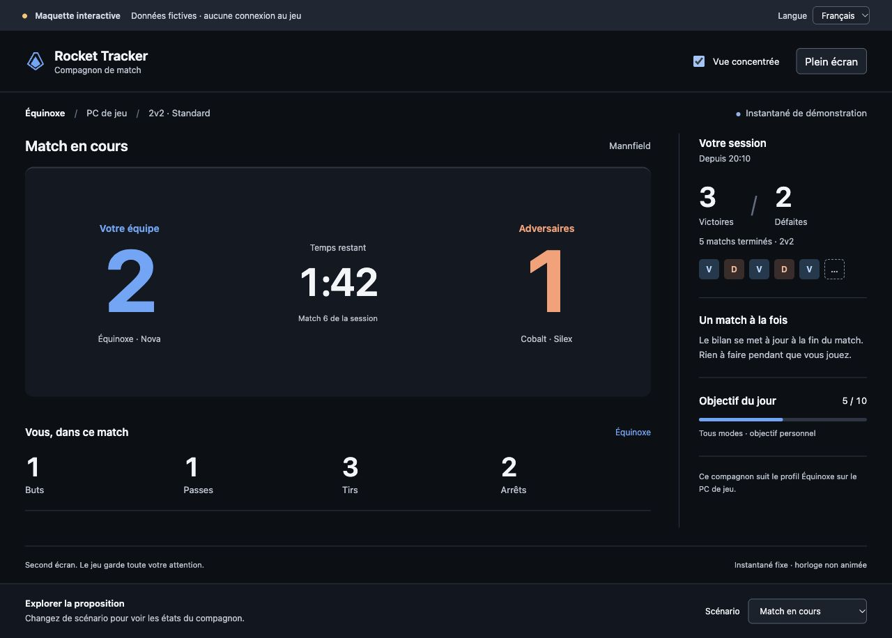
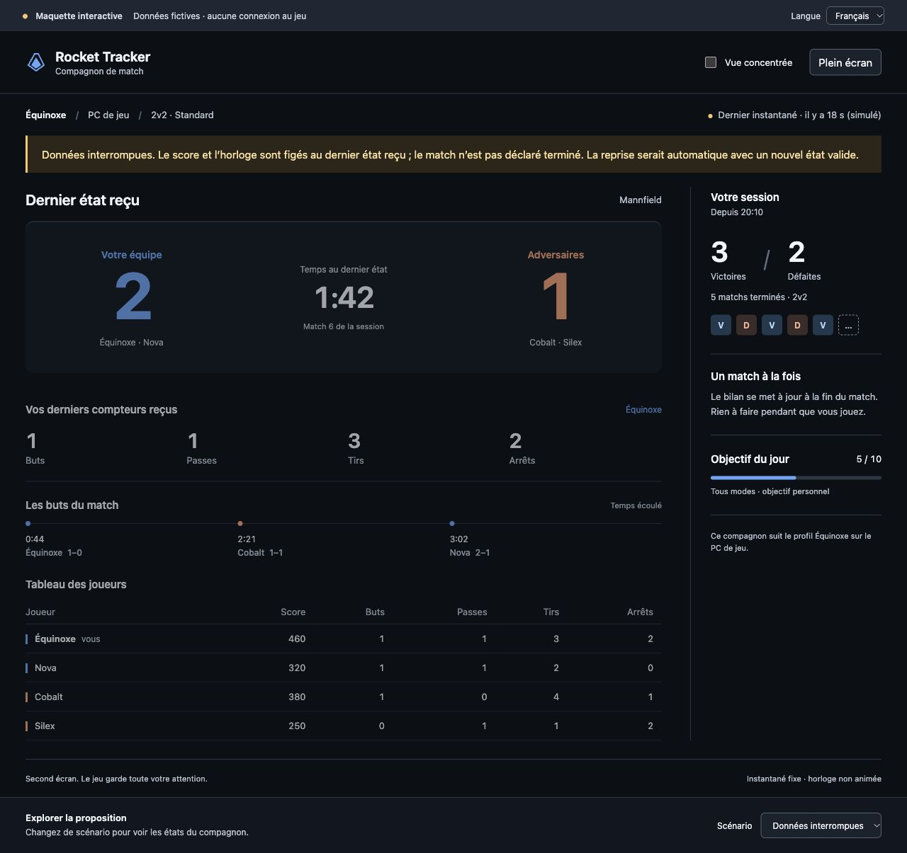

# Maquette In-game : compagnon second écran

**Proposition uniquement.** Ouvrir [index.html](index.html) via un serveur statique :

```sh
python3 -m http.server 4189 --bind 127.0.0.1 --directory docs/prototypes/ingame
```

Puis <http://127.0.0.1:4189>. Arrêter avec Ctrl+C. Depuis la racine du dépôt ;
Python 3 facultatif pour prévisualiser, aucune installation ou compilation.

Onze scénarios fixes, français/anglais, vue concentrée et plein écran volontaire.
Données fictives, aucune lecture/écriture de données de joueur ou requête API.
La simulation d’interruption ne mesure pas une vraie fraîcheur. Les contrôles
exploratoires ne sont pas un futur menu en match. Les captures sont générées
depuis cette maquette et n’illustrent pas une connexion réelle à Rocket League.

Voir [la proposition, les personas, les contrats et le plan](../../rfcs/ingame-second-screen.md).




