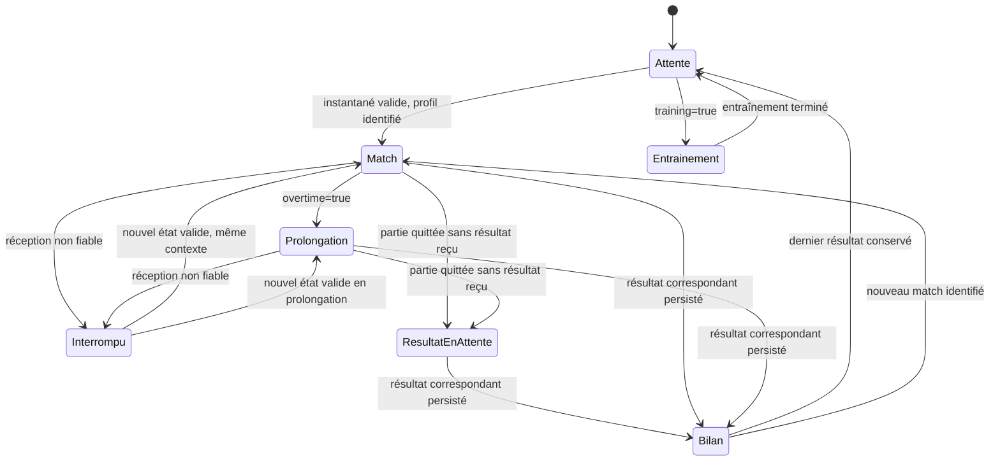
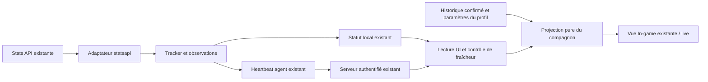

# Compagnon In-game sur second écran

Statut : **proposition à discuter**, maquette interactive uniquement. Demande du
18 octobre 2026 : privilégier un compagnon sur second écran. Aucun branchement
au jeu, aucune nouvelle route et aucune modification du tracker dans cette PR.

## Intention

Donner au joueur un repère pendant la partie, puis un bilan au coup de sifflet,
sans demander de quitter le jeu. La vue `#/live` existe déjà : la proposition est
une évolution de cette vue, avec une hiérarchie plus calme et un mode concentré.

Le choix de conception proposé est de faire passer le score, le temps et quatre
compteurs personnels avant l’analyse. Les estimations de victoire, comparaisons
et détails de mouvement restent dans les vues analytiques existantes. C’est une
hypothèse UX à tester avec des joueurs, pas une mesure d’amélioration acquise.


## Voir et manipuler la maquette

Depuis la racine du dépôt, servir **uniquement le dossier de la maquette** :

```sh
python3 -m http.server 4189 --bind 127.0.0.1 --directory docs/prototypes/ingame
```

Ouvrir <http://127.0.0.1:4189>. Python 3 est un outil de prévisualisation facultatif,
pas une dépendance du produit. Aucun paquet supplémentaire ni build nécessaire.
Arrêter le serveur avec Ctrl+C. Les fichiers HTML/CSS/JS sont aussi conservés
ensemble pour consultation ; la vérification navigateur a utilisé HTTP loopback.

- **Scénario** : chargement, match, prolongation, fin confirmée, résultat en attente,
  entre deux matchs, entraînement, capture partielle, profil inconnu, données
  interrompues et agent hors ligne.
- **Vue concentrée** : garde score, horloge, statistiques personnelles et session ;
  masque chronologie et tableau détaillé.
- **Plein écran** : uniquement après action utilisateur, avec retour visible et
  gestion du refus navigateur. Aucun raccourci global capturé.
- **Langue** : français et anglais ; choix temporaire, sans stockage navigateur.

La bannière de maquette reste visible. Toutes les données sont fictives, fixes et
explicitement signalées. Le sélecteur simule des états, pas leur détection. Aucun
`fetch`, WebSocket, cookie, localStorage, lecture de base ou écriture métier.
Les contrôles d’exploration appartiennent à la maquette, pas au futur écran joueur.

## Personnes et usages

| Persona de conception | Besoin | Parcours proposé |
| --- | --- | --- |
| Joueur avec deux moniteurs | Comprendre le match d’un coup d’œil sans interaction | Ouvrir `#/live` sur l’autre écran avant de jouer ; activer la vue concentrée si souhaité. |
| Joueur qui travaille sa régularité | Retrouver son bilan entre deux parties | Fin confirmée → dernier résultat et session ; prochain match → nouveau score. |
| Joueur auto-hébergé | Savoir si les informations sont encore récentes | Voir le périphérique/profil et l’état de réception ; ne pas confondre coupure et fin de match. |

Ce sont des personas proposés pour cadrer les tests, pas des entretiens réalisés.
Sur le même PC, « second écran » signifie une seconde fenêtre du navigateur,
pas un autre appareil ni l’exposition réseau du serveur local. Un autre appareil
relève du serveur auto-hébergé et de sa connexion authentifiée existante.

## Organisation de la vue

```text
Profil / PC / mode                               État des données
┌─────────────────────────────────┬─────────────────────┐
│ Votre équipe   Horloge   Adverse │ Session terminée    │
│       2         1:42       1     │ 3 victoires / 2 D   │
│                                 │ Résultats récents   │
│ Buts   Passes   Tirs   Arrêts    │                     │
│                                 │ Objectif du jour    │
│ Buts du match + tableau joueurs  │                     │
│ (masqués en vue concentrée)      │                     │
└─────────────────────────────────┴─────────────────────┘
```

Couleurs et typographie reprennent le produit : fond graphite, équipe suivie et
adversaire différenciés, chiffres tabulaires. La production doit respecter la
couleur d’équipe réelle ; « votre équipe » ne signifie pas toujours bleu.
Le texte et les valeurs restent compréhensibles sans dépendre de la couleur.
La liste de buts est ordonnée, ses espacements ne représentent pas une échelle
temporelle. Pas d’animation, son, notification bloquante ou conseil causal en match.

## États et invariants proposés

| État | Affichage | Ce qu’il faut préserver en production |
| --- | --- | --- |
| Chargement | Aucun score affiché | Ne pas utiliser un ancien statut comme réponse initiale du nouveau contexte. |
| Résultat en attente | Derniers compteurs reçus, avertissement, session inchangée | Préserver la distinction score observé / résultat confirmé après save ou upload retardé. |
| Agent hors ligne | Dernier instantané explicitement figé, action de diagnostic | Ne pas confondre panne du serveur, agent absent et jeu déconnecté. |
| Match valide | Score, horloge reçue, compteurs, session antérieure | Aucun résultat courant ajouté au bilan avant sauvegarde confirmée. |
| Prolongation | Score égal, temps additionnel préfixé `+` | Respecter `overtime`, ne pas relancer un décompte de cinq minutes. |
| Fin confirmée | Résultat sauvegardé, statistiques finales, session actualisée | Attendre le record persisté correspondant au match/profil, pas seulement `live=null`. |
| Entre deux matchs | Dernier résultat confirmé, identifié comme passé | Aucun faux match actif, aucune nouvelle victoire ajoutée au fil des polls. |
| Entraînement | Écran neutre, session compétitive inchangée | Ne pas transformer `live.training=true` en match ou en victoire/défaite. |
| Capture partielle | Score/horloge reçus, avertissement | Masquer les cumuls individuels et la chronologie incomplète ; zéro n’est pas absence. |
| Profil non identifié | Perspective et données individuelles masquées | `me=null` ne doit pas devenir l’équipe zéro ; conserver seulement le contexte précédent clairement étiqueté. |
| Réception interrompue | Dernier instantané daté, horloge figée et avertissement | Ni déduction de fin ni interpolation. Nouvel instantané valide → reprise ; pas d’âge inventé. |

Le composant peut cumuler les états dégradés : une capture partielle peut aussi
être périmée. Le sélecteur isole les cas pour la discussion ; ce n’est pas la
machine d’état définitive. Un nouveau match, un profil ou un utilisateur changeant
invalide les anciennes réponses et caches avant tout affichage. Quand l’état est
incertain, conserver l’incertitude plutôt que mélanger deux matchs.



Capture partielle et identité inconnue sont des qualificatifs orthogonaux, pas
une preuve de fin. Si aucune partie n’a encore été sauvegardée, l’attente doit
inviter à lancer une partie, sans inventer de dernier résultat.

## Faisabilité et limites observées

Référence de cette proposition : `main` **`cfa461c`**. La PR #8 **`f764587`** est
une référence de convergence en revue, pas une dépendance pour voir la maquette.
Les liens suivants visent la révision observée et non une branche mouvante.

| Information | Source existante | Limite à garder |
| --- | --- | --- |
| Score, horloge, prolongation, équipe, joueurs et compteurs | [`Tracker.Live`](https://github.com/KcivazB/rocket-tracker/blob/cfa461c/internal/tracker/tracker.go), [`status`](https://github.com/KcivazB/rocket-tracker/blob/cfa461c/internal/server/server.go) | `me` peut être absent, `partial` peut être vrai ; ne pas inventer la perspective. |
| Profil, historique, session, objectif | [`renderLive`, `liveSessionCard`, `liveIdle`](https://github.com/KcivazB/rocket-tracker/blob/cfa461c/web/app.js) et paramètres existants | Réutiliser les filtres profil/cohorte ; la maquette ne recalcule aucune vraie session. |
| Flux local | [`/api/status`](https://github.com/KcivazB/rocket-tracker/blob/cfa461c/internal/server/server.go) | `connected` indique le transport ; ce n’est pas l’âge de la dernière frame. |
| Flux auto-hébergé | [`hubStatus`, registre agents](https://github.com/KcivazB/rocket-tracker/blob/cfa461c/internal/server/hub.go), [`heartbeat`](https://github.com/KcivazB/rocket-tracker/blob/cfa461c/internal/agent/agent.go) | Heartbeat toutes les 3 s, agent considéré en ligne pendant 15 s ; `agent.last_seen` date le rapport agent, pas chaque observation jeu. |
| Rang, MMR, playlist ranked/casual | [Limites actuelles](https://github.com/KcivazB/rocket-tracker/blob/cfa461c/README.md#limits) | Pas fournis par la Stats API ; exclus de ce compagnon initial. Le live actuel n’expose pas de variante ; « Standard » est ici une fixture de conception, pas une donnée disponible à afficher automatiquement. Le mode/variant n’est affiché que s’il est connu. |
| Boost instantané, carte tactique, qualité du réseau | Aucun contrat retenu pour cette proposition | Exclus ; aucune intégration BakkesMod/overlay/injection ni promesse FPS. |

`Live.Me` ne contient pas d’identifiant plateforme stable ; le sélecteur de profil
historique ne change pas l’identité du live. Avant d’associer une session au live,
le contrat doit donc résoudre cette association ; un nom seul ne suffit pas.
En attendant, afficher les périmètres séparément ou rendre le contexte personnel
indisponible. L’agent est choisi automatiquement (live, connexion, puis date) :
aucun sélecteur de PC supplémentaire n’est supposé exister.

La lecture indépendante a aussi identifié deux gates dans le polling existant,
sur la base figée comme dans #8 : un échec peut conserver l’ancien `live`, et deux
réponses de la même génération peuvent arriver dans l’ordre inverse. E2 doit
ajouter une qualification explicite du dernier état et une règle de séquencement
ou exclusion des polls ; les gardes de génération seules ne suffisent pas.
Ce sont des risques à traiter dans l’implémentation, pas des corrections livrées
par cette maquette. Garder identité, fraîcheur et avertissements **dans le
conteneur mis en plein écran**, faute de quoi la vue peut les faire disparaître.

Le polling UI existe à 3 s. La latence cumulée jeu → agent → serveur → navigateur
ne constitue pas du temps réel garanti. **Avant de coder l’indicateur de fraîcheur**,
il faut définir la provenance et le sens d’un âge d’observation local/serveur,
le comportement pendant pause/connexion silencieuse et le délai d’avertissement.
Le « 18 s » de la maquette est un exemple fictif, pas un seuil adopté.
Ne pas exposer une URL/API supplémentaire ou un jeton dans une URL pour ce mode.

## Architecture proposée



Une projection UI pure transforme statut + couverture + historique en données
d’affichage ; les effets restent dans le polling existant. Réutiliser les gardes
de génération et le scope utilisateur/profil, sans déplacer les calculs métier
dans un composant DOM. Pas de nouvelle couche Go ni de stockage pour cette
maquette. Une modification de contrat de fraîcheur éventuelle fera l’objet d’un
ADR proposé et de tests, puis d’une décision mainteneur avant intégration.

## Epics et plan d’implémentation proposé

| Étape / epic | US et critères observables | Documentation dans la même étape |
| --- | --- | --- |
| E1 · Valider le compagnon | US1 : score et temps compréhensibles à distance. US2 : lire le bilan sans action en match. Faire tester normal/concentré sur les moniteurs réels ; consigner objections et choix, sans annoncer de résultat avant test. | Réviser cette proposition, conserver captures et décisions UX ; ADR si un choix architectural durable est arrêté. |
| E2 · Fixer les contrats de contexte | US3 : interruption signalée sans fausse fin ; US4 : bon utilisateur/profil/périphérique. Given erreur réseau ou ancien poll, When contexte change, Then aucune donnée étrangère ou ancienne réintroduite. Définir âge de réception vs âge de frame, couvrir `me=null`, `partial`, training, offline et absence d’historique. | `docs/SPEC.md` pour payload/états, `docs/ARCHITECTURE.md` pour responsabilités ; ADR de fraîcheur si contrat modifié. |
| E3 · Brancher une tranche locale | US5 : ouvrir `#/live` dans une seconde fenêtre, concentré et plein écran volontaire ; FR/EN. Given nouveau match identifié, When statut reçu, Then score, compteurs et OT corrects ; fin visible seulement après résultat confirmé. Tests de projection Node puis scénario local simulé, sans base réelle. | `README.md` pour le parcours, `docs/DEVELOPMENT.md` pour les commandes, `docs/SPEC.md` pour focus/navigation et compatibilité. |
| E4 · Qualifier le serveur et les reprises | US6 : même compagnon auto-hébergé avec scope existant. Given agent expiré, profil changé, save retardé, reconnexion ou doublon, Then état honnête et session comptée une fois. Vérifier réponses obsolètes, 401 et multi-PC ; pas de jeton navigateur dédié. | `docs/SELF_HOSTING.md` et guide d’exploitation effectivement présent après convergence avec #8 pour diagnostic/reprise ; matrice de preuves dans l’issue/PR. |
| E5 · Qualifier l’usage avant livraison | Vérifier FR/EN, contraste, clavier, 1280×720 et 1920×1080, zoom 200 %, plein écran, second moniteur Windows et jeu réel. Mesurer coût des polls/rendu et latence observée ; fixer ensuite des critères avec le mainteneur, sans inventer de budget. | Guide utilisateur à jour et limites connues ; preuves de validation dans la PR ; notes de release uniquement lors d’une release autorisée. |

Ordre E1 → E2 → E3 → E4 → E5. La future intégration de code devra partir de la
branche courante après résolution de #8 pour conserver ses corrections de
cohortes, version, sauvegarde et sécurité. Cette PR documentaire indépendante
peut être relue dès maintenant ; elle ne doit pas annoncer le mode comme livré.

## Hors périmètre et questions à trancher

- Overlay natif, surimpression dans le jeu, capture vidéo, nouveau plugin et
  affichage sur un autre appareil en mode local.
- Coach automatisé, prédiction de victoire en grand, faux MMR, boost ou positions
  instantanés non contractualisés ; comptes d’autres joueurs par défaut.
- Décisions restantes : vue concentrée par défaut ? Quelle information manque
  vraiment pendant la partie ? Quel signal fiable pour la fraîcheur ? Quel
  comportement après un changement automatique de périphérique ?

La PR et l’issue sont le lieu de discussion. La maquette valide seulement une
proposition d’interface avec des fixtures ; elle ne qualifie pas une partie réelle.
